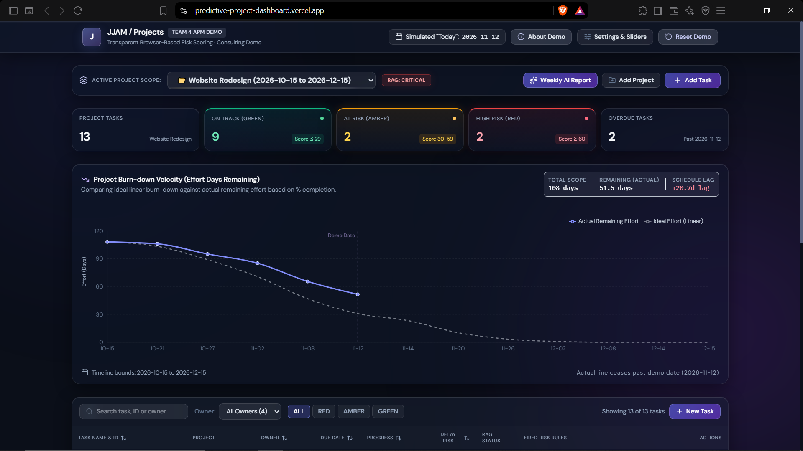
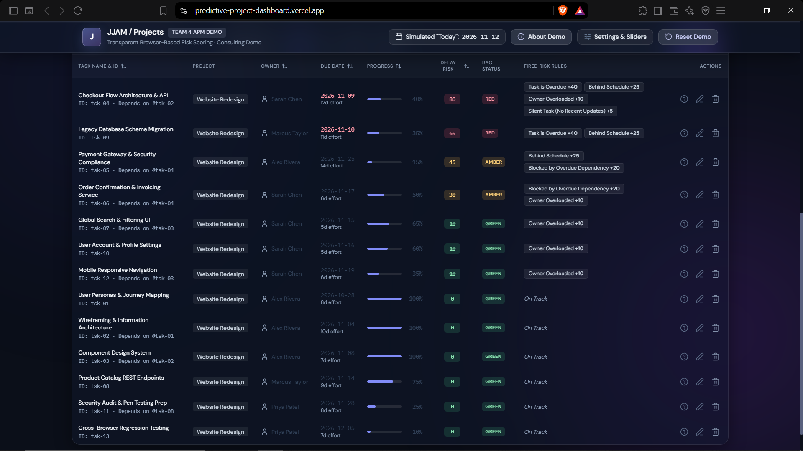
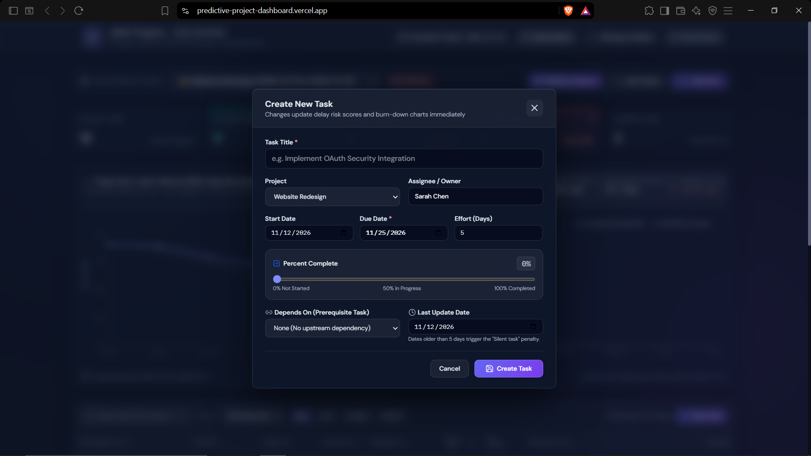
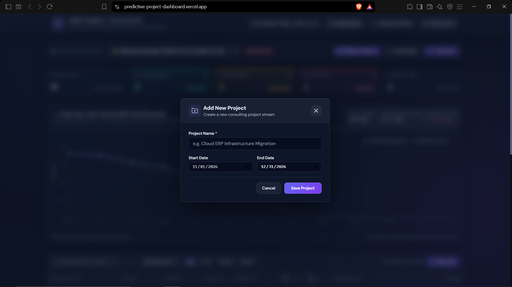
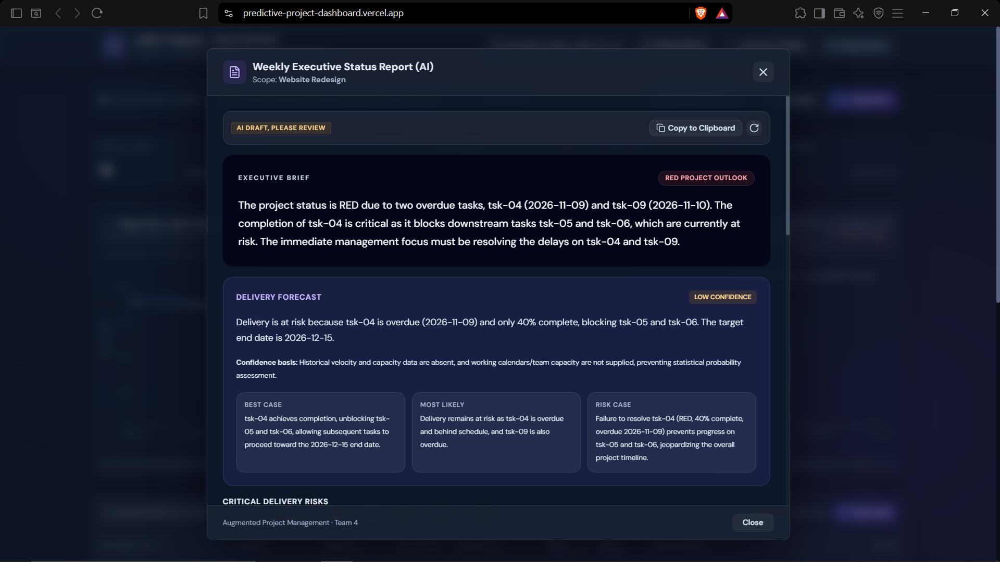

# Predictive Project Dashboard

> **Business-School Consulting Demo — Augmented Project Management (Team 4)**  
> *A local-first predictive dashboard that identifies slipping deliverables before deadlines occur using transparent rule-based scoring and generative AI.*

[](https://vitejs.dev/)
[](https://react.dev/)
[](https://tailwindcss.com/)
[](https://recharts.org/)
[](https://ai.google.dev/)

---

## 🎯 Executive Overview

Traditional project management tools alert managers *after* a milestone has been missed. The **Predictive Project Dashboard** introduces augmented project intelligence:
1. **Transparent Rule-Based Risk Engine:** Calculates mathematical delay risk scores (0–100) and RAG status in the browser using transparent, tunable heuristics.
2. **Generative AI Root Cause & Actions:** Google Gemini or NVIDIA API Catalog can write grounded explanations of delays, delivery forecasts, concrete next actions, and weekly reports.
3. **PM Remains in Control:** Every AI draft is labeled *"AI draft, please review"* with full **Accept**, **Edit**, **Dismiss**, and **Regenerate** capabilities.
4. **Local-First & Demo-Resilient:** Project data stays in browser storage; a small same-origin API proxy keeps provider keys server-side. Pre-calibrated offline fallbacks (`aiFallback.json`) keep presentations working without a configured key.

---

## 📸 Screenshots

### Dashboard overview


### Task list and risk status


### Create a task


### Add a project


### Weekly AI report


---

## 🏗️ Architecture & Boundaries

The codebase is built with strict modular separation to ensure that screens remain decoupled from data sources and AI providers:

```
src/
├── data/
│   ├── sampleData.json       # Calibrated demo dataset (2 projects, 20 tasks)
│   └── aiFallback.json       # Pre-generated fallback responses for demo resilience
├── utils/
│   ├── riskEngine.js         # Deterministic scoring engine & threshold rules
│   ├── storage.js            # Storage abstraction layer (localStorage CRUD, import/export)
│   ├── aiService.js          # Browser client for the same-origin AI proxy
│   └── burndown.js           # Burn-down ideal vs actual remaining effort calculator
├── components/
│   ├── BurndownChart.jsx     # Recharts interactive burn-down visualization
│   ├── WhyFlaggedDrawer.jsx  # Rule breakdown & Generative AI analysis side drawer
│   ├── WeeklyReportModal.jsx # 5-line executive summary with copy to clipboard
│   ├── SettingsModal.jsx     # Rule weight sliders, thresholds, API key, backup/restore
│   ├── TaskModal.jsx         # Task creation & editing form with dependency picker
│   ├── ProjectModal.jsx      # New project creation form
│   └── AboutModal.jsx        # "Our demo vs real product" comparison table
├── App.jsx                   # Main executive dashboard
├── main.jsx                  # Application entry point
└── index.css                 # Tailwind CSS design system tokens & typography
api/ai.js                     # Vercel serverless AI proxy
server/                       # Server-only provider calls and request handler
```

- **Storage Isolation (`src/utils/storage.js`):** All `localStorage` interactions are isolated in this module. A cloud database (Firebase, Supabase, Postgres) can replace this single file in the future without modifying any UI component.
- **AI Isolation (`src/utils/aiService.js` + `server/`):** The browser sends prompts only to `/api/ai`. The server reads provider keys from environment variables, discovers available models, and calls Gemini or NVIDIA. Task analysis includes evidence-grounded delivery forecasts and suggested actions; weekly reports summarize project risk and proactive decisions.
- **Simulated Timeline:** Configurable **Demo Date** (default: `2026-11-12`) anchors all time elapsed percentages, overdue checks, and owner overload windows for consistent consulting demos.

---

## 🚀 Quickstart: Running Locally

### Prerequisites
- Node.js 20.19+ or 22.12+
- npm 9+

### 1. Clone & Install
```bash
# Navigate to the project directory
cd "JJAM_AI - Antigrav"

# Install dependencies (React, Vite, Tailwind CSS, Recharts, Lucide Icons)
npm install
```

### 2. Run the Development Server
Copy `.env.example` to `.env.local`, then set either `NVIDIA_API_KEY` or `GEMINI_API_KEY` in `.env.local`. Restart the server after changing these values.

```bash
npm run dev
```
Open **[http://localhost:5173](http://localhost:5173)** in your browser to experience the dashboard.

### 3. Run Automated Logic Verification
```bash
# Verify the mathematical risk engine against sample data
npm test

# Verify the burn-down chart calculation logic
node test-sprint2.js

# Verify the AI service and offline fallbacks
node test-ai-service.js
```

---

## 🔑 How to Configure a Live AI Provider

The application is fully functional **without** an API key using the included offline fallback dataset (`aiFallback.json`). To enable live AI generation:

1. Obtain a key from [Google AI Studio](https://aistudio.google.com/app/apikey) or the [NVIDIA API Catalog](https://build.nvidia.com/).
2. Click the **"Settings & Sliders"** button in the top navigation bar of the dashboard.
3. Select Google Gemini or NVIDIA API Catalog under **AI Provider & API Key**.
4. Put the key in `.env.local` under `GEMINI_API_KEY` or `NVIDIA_API_KEY`, then restart `npm run dev`.
5. Select **Test Connection**. The app discovers an available model and reports which one it selected.

> **Security Note:** `.env.local` is ignored by Git; never commit API keys. For Vercel, add the selected key as a project environment variable. A public deployment should also add authentication or request rate limits before exposing the proxy.

---

## ☁️ How to Deploy to Vercel

The Vite frontend deploys with a Vercel Function at `/api/ai`:

### Method A: Deploy via Vercel CLI
```bash
npm install -g vercel
vercel
```
Accept the default prompts (`Framework Preset: Vite`, `Output Directory: dist`). Then add `NVIDIA_API_KEY` or `GEMINI_API_KEY` under the Vercel project's **Settings → Environment Variables** and redeploy.

### Method B: Deploy via Vercel Web Dashboard
1. Push this directory to your GitHub or GitLab repository.
2. Go to [vercel.com/new](https://vercel.com/new) and select the repository.
3. Configure the project settings:
   - **Framework Preset:** `Vite`
   - **Build Command:** `npm run build`
   - **Output Directory:** `dist`
   - **Install Command:** `npm install`
4. Add the provider key under **Settings → Environment Variables**, then deploy. Your dashboard and same-origin API will be live at `https://your-project.vercel.app`.

---

## 📊 Calibrated Demo Dataset (2026-11-12)

With the default Demo Date set to **`2026-11-12`**, the dataset yields:
- **Exactly 2 RED Tasks (Score ≥ 60):**
  - `tsk-04` (*Checkout Flow Architecture & API*, Score: **80**): Overdue by 3 days, behind schedule (40% vs 100%), silent for 8 days, and assignee Sarah Chen is overloaded; it **blocks 2 downstream tasks** (`tsk-05` and `tsk-06`).
  - `tsk-09` (*Legacy Database Schema Migration*, Score: **65**): Overdue by 2 days, behind schedule (35% vs 100%).
- **Exactly 3 AMBER Tasks (Score 30–59):**
  - `tsk-05` (*Payment Gateway Integration*, Score: **45**): Lagging timeline by 30.8% and blocked by overdue parent `tsk-04`.
  - `tsk-06` (*Order Confirmation & Invoicing*, Score: **30**): Blocked by overdue parent `tsk-04` and assignee Sarah Chen is overloaded.
  - `tsk-17` (*Push Notification Microservice*, Score: **40**): Overdue by 1 day at 90% completion.
- **15 GREEN Tasks (Score 0–29 or Completed):** Completed deliverables are locked to Green (Score = 0).
- **Overloaded Owner:** Assignee **Sarah Chen** holds 4 open tasks due between Nov 12 and Nov 19.
- **Silent Task:** `tsk-04` has not logged an update for 8 days (> 5 days threshold).

---

## ✅ Acceptance Test Checklist (run before presenting)

| Test Item | Verification Step | Result |
| :--- | :--- | :---: |
| **LocalStorage Persistence** | Add a task or accept an AI draft, then refresh the page. | Pending |
| **Instant Score Reactivity** | Edit a task's `% Complete` slider or `Due Date`. Score updates instantly. | Pending |
| **Live Slider Sensitivity** | Adjust rule weight sliders in Settings. Scores recalculate across entire app. | Pending |
| **Offline Fallback Safety** | Remove API key or disconnect network. Fallback sample renders without crash. | Pending |
| **Reset Demo** | Click "Reset Demo" button. State restores to exactly 2 Red, 3 Amber, 15 Green. | Pending |
| **Burn-down Chart** | Recharts displays ideal linear line vs actual remaining effort up to Demo Date. | Pending |
| **Explainability Audit** | Click "What the AI was given" accordion to inspect exact JSON payload and prompt. | Pending |
| **PM Review Controls** | Accept, edit inline, dismiss, and regenerate AI outputs. | Pending |
| **Data Safety Net** | Export and import full application state as a JSON backup file. | Pending |
| **About Comparison Table** | "About this demo" displays the demo vs real product comparison. | Pending |

---

## 👥 Augmented Project Management — Team 4
*Business-School Consulting Demonstration Prototype · October 2026*
